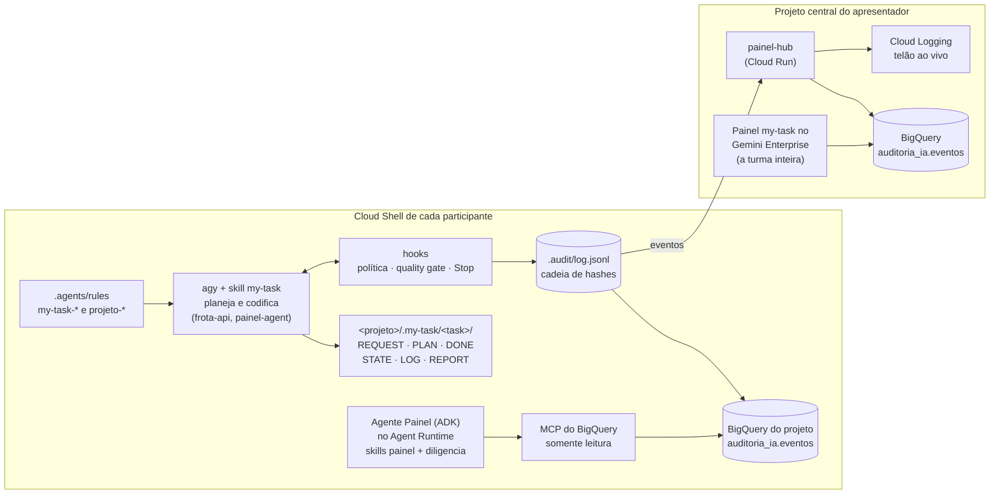
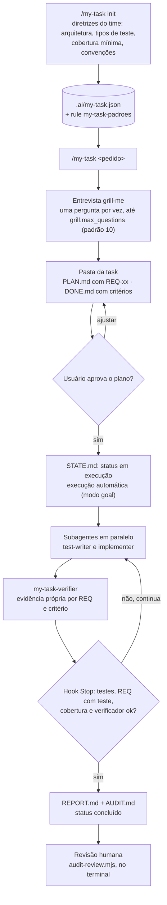

# Primeiros passos com o Antigravity — edição Embraer

Laboratório hands-on de 90 minutos para o **[Embraer] Antigravity Labs — Google Cloud & IEBT**, aderente ao roteiro *Workshop: Primeiros Passos com o Antigravity*.

| Bloco do roteiro | Tarefa do lab |
|---|---|
| Introdução: ofertas do Antigravity, ambiente via Gemini Enterprise, ferramentas | 1. Preparar o ambiente com o Antigravity CLI e o agents-cli |
| Introdução: permissões de execução segura, regras de workspace e agente base | 2. Criar as regras de workspace e a execução segura (`/my-task init` e painel) |
| SDLC com Antigravity: planejar e codificar com regras | 3. Planejar e codificar uma API no projeto `frota-api` |
| Cenário 1: agente com ADK Skills e validação local · Cenário 3: extensibilidade com MCP | 4. Construir o agente Painel com ADK Skills e o MCP do BigQuery |
| Cenário 2: deploy no Agent Runtime via agents-cli | 5. Fazer o deploy do agente no Agent Runtime |
| Cenário 2: publicação no Gemini Enterprise App | 6. Conectar e publicar o agente no Gemini Enterprise App |
| Governança e práticas de produção | 7. Integridade, revisão humana e o painel da turma |

## Como as peças se encaixam



### O fluxo de uma task na `my-task`



- **Skill `my-task` (no `agy`):** genérica, planeja e codifica qualquer task em qualquer repositório, com rules, hooks, subagentes, quality gate, verificador e revisão humana. Cada ação vira evento na trilha local (cadeia de hashes), no BigQuery do projeto e no painel central.
- **Rules do projeto:** o que é de cada repositório (`.agents/rules/projeto-frota-api.md`, `.agents/rules/projeto-painel-agent.md`).
- **Agente Painel (ADK):** skills `painel` (o que cada um está fazendo) e `diligencia` (a task seguiu o processo?), MCP do BigQuery somente leitura, publicado no Agent Runtime e no Gemini Enterprise.

## Estrutura

```text
workshop-agy-embraer/
├── lab_instructions.md                  # roteiro do aluno (colar no Qwiklabs)
├── .agents/skills/my-task/              # skill do agy: planejar e codificar com regras, hooks, subagentes e auditoria
├── .agents/rules/projeto-*.md           # rules dos projetos deste repositório
├── frota-api/                           # repositório de exemplo: FastAPI, DDL, config, padrões e testes
├── skills/
│   ├── painel/                          # ADK Skill: atividade do time a partir da trilha
│   └── diligencia/                      # ADK Skill: parecer sobre se uma task seguiu o processo
├── docs/
│   ├── referencia-adk.md                # padrões de código ADK testados (skills, tabela_do_painel, MCP do BigQuery)
│   └── apresentador.md                  # tempo, checklist do evento e problemas comuns
├── painel-central/                      # projeto central do apresentador: hub no Cloud Run, schema e deploy.sh
├── scripts/check_progress.sh            # verificador de progresso do aluno (tarefas 1 a 7)
├── scripts/testes.sh                    # testes de todos os projetos (usado pelo quality gate)
├── terraform/                           # setup do projeto do aluno: APIs e dataset auditoria_ia
└── qwiklabs/Archive.zip                 # pacote do terraform para o project_0
```

## Publicar no Qwiklabs

1. Faça push deste repositório para `github.com/marcuspmd/workshop-agy-embraer` (público). O roteiro clona dessa URL.
2. Se mudar algo em `terraform/`, gere o pacote de novo:

   ```bash
   cd terraform && zip -r ../qwiklabs/Archive.zip runtime.yaml main.tf provider.tf variables.tf scripts/script.sh && cd ..
   ```

3. No editor do lab no Qwiklabs:
   - aba **Instructions**: cole o `lab_instructions.md`;
   - aba **Lab Resources**: no `project_0`, envie o `qwiklabs/Archive.zip` e clique em **Update Lab Resource**;
   - em **Student Visible Outputs**, marque `project_0.console_url`, `project_0.project_id`, `user_0.username`, `user_0.password` e `project_0.default_region`.
4. Prepare o painel central (`painel-central/README.md`) e teste o lab de ponta a ponta seguindo `docs/apresentador.md`.

## Limites

É uma demonstração do tipo de evidência que um time consegue gerar com IA, não um kit de conformidade. Não certifica nada e não substitui ED-12C/DO-178C nem a qualificação de ferramentas (ED-215/DO-330). A `frota-api` e os dados dela são fictícios.
