# Projeto central do apresentador, passo a passo

Material interno: não vai para o Qwiklabs. Este guia monta, num projeto Google Cloud **seu** (fora do Qwiklabs), tudo o que o telão mostra durante o evento:

- o **hub** (`painel-hub`, no Cloud Run), que recebe os eventos da `my-task` de cada participante;
- a tabela central **`auditoria_ia.eventos`** no BigQuery, com a turma inteira;
- a **sala ao vivo** (`/sala`, servida pelo próprio hub): um avatar por pessoa, com o que a IA está fazendo, a etapa da task e o progresso; clicando numa pessoa, as tasks dela, os subagentes, os bloqueios e a linha do tempo;
- o **Logs Explorer** ao vivo, com cada ação e cada bloqueio em segundos;
- o **agente Painel** no Agent Runtime, apontado para a tabela central, e o app **Painel da Turma** no Gemini Enterprise.

```mermaid
flowchart LR
    alunos["Cloud Shell dos participantes<br/>(projetos Qwiklabs)"] -- "POST /eventos<br/>X-Painel-Token" --> hub
    voce["Seu Cloud Shell<br/>(ensaio e demo)"] -- "insertAll direto<br/>(--sem-central)" --> bq
    subgraph central["Seu projeto central"]
        hub["painel-hub<br/>Cloud Run"] --> bq[("BigQuery<br/>auditoria_ia.eventos")]
        hub --> logs["Cloud Logging<br/>telão ao vivo"]
        hub --> sala["/sala<br/>sala ao vivo (SSE)"]
        agente["Agente Painel<br/>Agent Runtime"] -- "MCP somente leitura" --> bq
        ge["Gemini Enterprise<br/>app Painel da Turma"] --> agente
    end
```



## Quando fazer cada parte

| Quando | O quê | Tempo |
| :--- | :--- | :--- |
| Uma semana antes | Partes 1 a 6: projeto, hub, ensaio do lab, agente, Gemini Enterprise | ~2 h |
| Na véspera | Parte 7: limpar o ensaio, token novo, teste de fumaça | 15 min |
| No dia | Parte 8: telão | — |
| Depois do evento | Parte 9: desligar e apagar | 5 min |

> ⚠️ **Use a sua conta, não a de estudante.** Faça tudo num perfil do Chrome só seu (não na janela anônima do Qwiklabs). No dia do evento, deixe o projeto central num perfil e um lab de teste do Qwiklabs em outro, para não misturar as contas.

---

## Parte 1. Criar e preparar o projeto

O que o Qwiklabs faz sozinho no projeto do aluno (`terraform/scripts/script.sh`) você faz aqui à mão.

1. ☁️ **Console Google Cloud:** crie um projeto novo, por exemplo `agy-painel-central`, e **vincule uma conta de faturamento**. Sem faturamento, o Cloud Run, o Agent Runtime e o Gemini Enterprise não sobem.

   > Se a sua conta pertence a uma organização, confira duas políticas antes de seguir: **Domain restricted sharing** (`constraints/iam.allowedPolicyMemberDomains`) impede o hub público (`allUsers`) no Cloud Run, e **`constraints/vertexai.allowedModels`** pode bloquear o modelo do lab. Se alguma delas estiver ativa e você não puder abrir exceção, use um projeto fora da organização (conta Google pessoal com faturamento).

2. ☁️ **Console Google Cloud:** com o projeto selecionado, clique em **Ativar o Cloud Shell**.

3. 💻 **Terminal Cloud Shell (`$`):** fixe o projeto e a região e grave no `~/.bashrc`. Troque `agy-painel-central` pelo ID do seu projeto:

   ```bash
   export PROJECT_ID=agy-painel-central
   export REGION=us-central1
   gcloud config set project $PROJECT_ID
   gcloud config set compute/region $REGION
   cat << EOF >> ~/.bashrc
   export PROJECT_ID=${PROJECT_ID}
   export REGION=${REGION}
   export PATH="\$HOME/.local/bin:\$PATH"
   EOF
   ```

4. 💻 **Terminal Cloud Shell (`$`):** ligue as mesmas APIs que o projeto do aluno tem. Leva 1 a 2 minutos:

   ```bash
   gcloud services enable \
     serviceusage.googleapis.com cloudresourcemanager.googleapis.com compute.googleapis.com \
     iam.googleapis.com iamcredentials.googleapis.com aiplatform.googleapis.com \
     cloudaicompanion.googleapis.com businessaicode.googleapis.com discoveryengine.googleapis.com \
     storage.googleapis.com bigquery.googleapis.com run.googleapis.com cloudbuild.googleapis.com \
     artifactregistry.googleapis.com logging.googleapis.com monitoring.googleapis.com cloudtrace.googleapis.com
   ```

5. 💻 **Terminal Cloud Shell (`$`):** clone o repositório:

   ```bash
   git clone https://github.com/marcuspmd/workshop-agy-embraer.git ~/workshop-agy-embraer
   cd ~/workshop-agy-embraer
   ```

---

## Parte 2. Publicar o hub e a tabela central

1. 💻 **Terminal Cloud Shell (`$`):** rode o deploy. Na primeira vez, o Cloud Run pergunta se pode criar o repositório do Artifact Registry: responda `Y`. Leva de 3 a 5 minutos:

   ```bash
   cd ~/workshop-agy-embraer
   PROJECT_ID=$PROJECT_ID ./painel-central/deploy.sh
   ```

   O script cria o dataset `auditoria_ia` e a tabela `eventos` (particionada por `ts`), a conta de serviço `painel-hub` (grava na tabela e lê o histórico), publica o `painel-hub` no Cloud Run e chama `/saude`. No fim, mostra a **URL** e o **TOKEN**, que vão para a turma, e o link da **sala ao vivo** (`URL/sala?k=<chave>`), que fica só com você.

   > O hub roda com **uma instância só, sempre ligada** (`--min-instances 1 --max-instances 1`): a sala guarda o estado da turma em memória e, se o serviço reiniciar, refaz o estado com as últimas 24 h do BigQuery. Uma instância dá conta de uma turma com folga. A instância ligada custa enquanto o serviço existir: apague-o depois do evento (Parte 9).

2. 💻 **Terminal Cloud Shell (`$`):** guarde os dois numa variável e num arquivo fora do repositório (o token **não** vai para o git):

   ```bash
   export PAINEL_URL=<URL mostrada>
   export PAINEL_TOKEN=<TOKEN mostrado>
   export PAINEL_SALA=<link da sala mostrado>
   printf 'PAINEL_URL=%s\nPAINEL_TOKEN=%s\nPAINEL_SALA=%s\n' "$PAINEL_URL" "$PAINEL_TOKEN" "$PAINEL_SALA" > ~/painel-central.env
   ```

3. 💻 **Terminal Cloud Shell (`$`):** teste de fumaça: mande um evento falso, como se fosse um participante:

   ```bash
   source ~/painel-central.env
   curl -s -X POST "$PAINEL_URL/eventos" \
     -H "X-Painel-Token: $PAINEL_TOKEN" -H 'Content-Type: application/json' \
     -d '{"rows":[{"ts":"'"$(date -u +%FT%TZ)"'","hash":"fumaca-'"$RANDOM"'","participante":"Teste Apresentador","evento":"SessionStart","ator":"human"}]}'; echo
   ```

   Deve voltar `{"recebidos":1}`. Com token errado, `401`.

4. ☁️ **Console Google Cloud (Logs Explorer):** abra **Logging → Logs Explorer**, cole a consulta abaixo e clique em **Executar consulta**. A linha `Teste Apresentador · SessionStart` deve aparecer:

   ```text
   resource.type="cloud_run_revision"
   resource.labels.service_name="painel-hub"
   jsonPayload.tipo="my-task"
   ```

   Clique em **Salvar consulta** com o nome `Telão my-task`: é a tela do evento.

5. 🌐 **Navegador:** abra o link da sala (`echo $PAINEL_SALA`). `Teste Apresentador` aparece como uma mesa.

6. 💻 **Terminal Cloud Shell (`$`):** ensaie a sala com uma turma simulada. O simulador faz 8 pessoas passarem pelo lab inteiro (bloqueios, entrevista, plano, execução com subagentes, quality gate, verificação, conclusão e revisão) em uns 4 minutos; com `--velocidade 2`, na metade:

   ```bash
   python3 painel-central/simular.py --url $PAINEL_URL --token $PAINEL_TOKEN --pessoas 8
   ```

   Na sala, clique numa pessoa: o painel lateral mostra a task atual com as etapas, os critérios de pronto, os subagentes trabalhando naquele momento, as tasks, os bloqueios e a linha do tempo ao vivo. Os nomes terminam em `(simulação)` e somem quando você limpar a tabela na véspera (Parte 7).

7. ☁️ **Console Google Cloud (BigQuery Studio):** confira as linhas na tabela:

   ```sql
   SELECT ts, participante, evento, recebido_em
   FROM `auditoria_ia.eventos`
   ORDER BY recebido_em DESC
   LIMIT 20
   ```

---

## Parte 3. Ensaiar o lab no projeto central

Para o agente Painel ter dados de verdade e para você ensaiar, rode as Tarefas 1 a 4 do `lab_instructions.md` **no seu Cloud Shell**, com estas diferenças:

| Passo do roteiro | No projeto central |
| :--- | :--- |
| Tarefa 1, variáveis | Já feito na Parte 1. Pule o bloco de variáveis. |
| Tarefa 1, autenticação do `agy` | Use a **sua** conta. No passo 5, cole o ID do projeto central. No passo 4, **Pay As You Go**. |
| Tarefa 1, `/model` | Escolha o mesmo modelo da turma (**Gemini 3.8 Flash**), para ensaiar com o mesmo comportamento. |
| Tarefa 2, passo 5 (`conectar-painel.mjs`) | Use **`--sem-central`** (veja abaixo). |
| Tarefa 2, "Verificar meu progresso" | Não existe fora do Qwiklabs. Use só `./scripts/check_progress.sh N`. |

Na Tarefa 2, passo 5, ligue a telemetria assim:

```bash
cd ~/workshop-agy-embraer
node .agents/skills/my-task/scripts/conectar-painel.mjs --nome "Apresentador" --sem-central
```

> 💡 **Por que `--sem-central`?** No projeto central, o "BigQuery do projeto" e a tabela do hub são a mesma tabela. Com `--url` e `--token`, cada evento seria gravado duas vezes (uma direto, outra pelo hub), e a deduplicação do BigQuery por `insertId` é só de melhor esforço. Com `--sem-central`, seus eventos vão direto para `auditoria_ia.eventos`, sem passar pelo hub; eles aparecem no BigQuery e no agente, mas **não** no Logs Explorer nem na sala ao vivo (a sala só lê o histórico do BigQuery quando o hub reinicia).
>
> O caminho pelo hub e pelo Logs Explorer você testa na Parte 6, com um lab do Qwiklabs de verdade.

Ao fim da Tarefa 4, confirme no ADK Web que o Painel responde com os seus dados. O `.env` do `painel-agent` já aponta para o projeto central, porque `PAINEL_PROJECT=${PROJECT_ID}`.

---

## Parte 4. Publicar o agente Painel no Agent Runtime

1. 💻 **Terminal Cloud Shell (`$`):** siga a Tarefa 5 do roteiro no projeto central (o pedido ao `agy` já usa `gcloud config get-value project` e `compute/region`). Guarde o **Resource Name**; ele também fica em `painel-agent/deployment_metadata.json`.

2. 💻 **Terminal Cloud Shell (`$`):** dê ao agente as permissões de leitura (Tarefa 6, passo 1):

   ```bash
   PROJECT_NUMBER=$(gcloud projects describe $PROJECT_ID --format="value(projectNumber)")
   RE_SA="service-${PROJECT_NUMBER}@gcp-sa-aiplatform-re.iam.gserviceaccount.com"
   for ROLE in roles/bigquery.dataViewer roles/bigquery.jobUser roles/mcp.toolUser; do
     gcloud projects add-iam-policy-binding $PROJECT_ID --member="serviceAccount:${RE_SA}" --role="$ROLE" --condition=None --quiet > /dev/null
   done
   echo "Permissões concedidas a ${RE_SA}"
   ```

   > Se o `agents-cli` tiver criado uma conta de serviço própria para o agente, conceda os mesmos papéis a ela. Para descobrir: **Agent Platform → Agent Runtime**, abra o agente e veja a conta em **Identity / Service account**.

3. 💻 **Terminal Cloud Shell (`$`):** guarde o agente gerado, para os próximos eventos não dependerem de refazer as Tarefas 3 e 4:

   ```bash
   gcloud storage buckets create gs://${PROJECT_ID}-painel --location=US 2>/dev/null || true
   tar --exclude=.venv --exclude=.env -czf /tmp/painel-agent.tgz -C ~/workshop-agy-embraer painel-agent
   gcloud storage cp /tmp/painel-agent.tgz gs://${PROJECT_ID}-painel/painel-agent-$(date +%F).tgz
   ```

   Para recuperar num Cloud Shell novo: `gcloud storage cp gs://<bucket>/painel-agent-<data>.tgz - | tar -xz -C ~/workshop-agy-embraer`, recriar o `.env` (Tarefa 4) e rodar o deploy de novo.

---

## Parte 5. Criar o app Painel da Turma no Gemini Enterprise

1. ☁️ **Console Google Cloud:** no campo **Pesquisar**, digite **Gemini Enterprise** e abra o produto. Num projeto novo, o Console pede para ativar o Gemini Enterprise: escolha a edição/teste disponível para a sua conta e aceite os termos. Sem isso, **Create your first app** não aparece.

   > Fora do Qwiklabs, o Gemini Enterprise é licenciado por usuário. Um teste gratuito costuma bastar para o evento; confira o prazo para ele não vencer antes do dia.

2. ☁️ **Gemini Enterprise:** clique em **Create your first app** e crie o app:

   ```text
   Painel da Turma
   ```

3. ☁️ **Gemini Enterprise:** siga os passos 4 a 7 da Tarefa 6 do roteiro: **Agents → Add Agent → Custom agent via Agent Runtime → Add**, **Skip** em Authorizations, e preencha:
   - **Agent name:** `Painel my-task`
   - **Agent description:** `Mostra como a turma usa a IA no desenvolvimento e faz a diligência de cada task`
   - **Agent Runtime reasoning engine:** o Resource Name da Parte 4

   Clique em **Create**. Se der erro de permissão, espere 30 a 60 s (propagação de IAM) e clique de novo.

4. 🌐 **Gemini Enterprise App (Preview):** em **Overview → Preview**, selecione **Painel my-task** e pergunte:

   ```text
   Resumo de hoje por pessoa: ações, bloqueios, quality gate e revisão.
   ```

   Deve aparecer `Apresentador` (do ensaio) e `Teste Apresentador` (do teste de fumaça). Guarde o link do Preview: é a segunda tela do telão.

---

## Parte 6. Testar com um projeto Qwiklabs de verdade

O teste que falta é o caminho real: um projeto de aluno mandando para o seu hub.

1. Abra um lab de teste no Qwiklabs (outro perfil do Chrome, janela anônima) e faça a Tarefa 1 e a Tarefa 2 até o passo 5, usando a `PAINEL_URL` e o `PAINEL_TOKEN` da Parte 2.
2. No **Logs Explorer** do projeto central, com **Stream logs** ligado, as linhas do participante de teste devem aparecer em segundos. Nos três pedidos de bloqueio da Tarefa 2, as linhas saem como `WARNING`.
3. No Cloud Shell do lab, `node .agents/skills/my-task/scripts/status.mjs` deve mostrar o **painel central** sem erro. Um `401` ali é token errado.
4. No **Painel da Turma**, pergunte `Quais bloqueios a turma teve e por quê?`: o participante de teste tem que aparecer.

Marque no `docs/apresentador.md` o item "Testar o envio de um projeto Qwiklabs para o hub central".

---

## Parte 7. Na véspera: limpar o ensaio e trocar o token

O token do ensaio já circulou por terminais e telas: troque. E a tabela deve começar o evento só com a turma.

1. 💻 **Terminal Cloud Shell (`$`):** guarde uma cópia do ensaio. Ela é o **Plano B** (dados para mostrar se a rede ou a cota falharem):

   ```bash
   bq --location=US mk --dataset ${PROJECT_ID}:auditoria_ensaio 2>/dev/null || true
   bq cp -f ${PROJECT_ID}:auditoria_ia.eventos ${PROJECT_ID}:auditoria_ensaio.eventos
   ```

2. 💻 **Terminal Cloud Shell (`$`):** apague a tabela e rode o deploy de novo. O script recria a tabela vazia e publica o hub com um token novo:

   ```bash
   cd ~/workshop-agy-embraer && git pull
   bq rm -f -t ${PROJECT_ID}:auditoria_ia.eventos
   PROJECT_ID=$PROJECT_ID ./painel-central/deploy.sh
   ```

   Atualize `~/painel-central.env` com a URL (a mesma), o **TOKEN novo** e o **link novo da sala** (a chave da sala também é trocada). É esse token que vai para o telão na Tarefa 2.

   > O `bq rm` é necessário: o `DELETE` do BigQuery não apaga linhas que ainda estão no buffer de streaming (até ~90 min depois do envio).

3. 💻 **Terminal Cloud Shell (`$`):** repita o teste de fumaça da Parte 2, passo 3, com `"participante":"Apresentador"`: assim a tabela não começa vazia e você confere o token novo.

4. Confira que o teste gratuito do Gemini Enterprise e o faturamento estão ativos.

---

## Parte 8. No dia: o que deixar aberto no telão

| Aba | O quê | Quando mostrar |
| :--- | :--- | :--- |
| 1 | Slide ou texto grande com a **URL** e o **TOKEN** | Tarefa 2 |
| 2 | **Sala ao vivo** (`$PAINEL_SALA`): a tela principal. Clique em quem travou ou em quem já chegou longe | Da Tarefa 2 até o fim |
| 3 | **Logs Explorer**, consulta salva `Telão my-task`, **Stream logs** ligado: os bloqueios em `WARNING`, linha a linha | Tarefa 2 (execução segura) |
| 4 | **BigQuery Studio** com a consulta de contagem por pessoa (abaixo) | Quando quiser mostrar que é SQL comum |
| 5 | **Gemini Enterprise**, app Painel da Turma, agente Painel my-task | Tarefa 7, para fechar |

> **Sala e Gemini Enterprise se completam.** O Gemini Enterprise responde em conversa e não hospeda uma tela própria que se atualiza sozinha; por isso a sala é uma página do hub. A sala mostra **o agora** (quem está trabalhando, em que etapa, o que a IA acabou de fazer); o agente responde **as perguntas** (diligência, resumo do dia, por que alguém foi bloqueado). Uma boa passagem no fechamento: aponte uma pessoa na sala e peça ao agente a diligência da task dela.

**Como ler a sala:**

| Na mesa | Significa |
| :--- | :--- |
| Anel verde pulsando, **IA trabalhando** | Chegou evento da IA nos últimos 3 min: escrevendo código, rodando comando, acionando subagente, corrigindo teste |
| Anel amarelo, **Esperando** | A IA parou e espera a pessoa: uma pergunta da entrevista, o plano para aprovar ou a revisão humana |
| Anel cinza, **Parada** / apagada, **Inativa** | Sem evento da IA há mais de 3 min / há mais de 15 min |
| Selo vermelho **bloqueio** | Um hook bloqueou uma ação no último minuto |
| Barra de 6 etapas | Entrevista → Plano → Execução → Verificação → Concluída → Revisada, com os critérios de pronto do `DONE.md` (`3/5 critérios`) |

Consulta para a aba 3:

```sql
SELECT participante,
       COUNT(*) AS acoes,
       COUNTIF(decisao = 'deny') AS bloqueios,
       COUNTIF(evento = 'QualityGate' AND resultado = 'passou') AS gates_ok,
       COUNTIF(evento = 'HumanReview') AS revisoes,
       MAX(ts) AS ultima_acao
FROM `auditoria_ia.eventos`
WHERE DATE(ts) = CURRENT_DATE()
GROUP BY participante
ORDER BY ultima_acao DESC
```

Perguntas para o Painel da Turma estão em `painel-central/README.md`, seção "Durante o evento".

**Plano B:** se o hub ou a rede falharem, mostre no BigQuery Studio a mesma consulta trocando `auditoria_ia` por `auditoria_ensaio`.

---

## Parte 9. Depois do evento

1. 💻 **Terminal Cloud Shell (`$`):** desligue o hub público (o token deixa de valer na hora):

   ```bash
   gcloud run services delete painel-hub --region $REGION --quiet
   ```

2. Decida o que fazer com os dados da turma. Se for guardar, exporte e apague a tabela; se não, apague o dataset:

   ```bash
   bq rm -r -f -d ${PROJECT_ID}:auditoria_ia
   ```

3. Para não pagar nada parado: apague o agente em **Agent Platform → Agent Runtime** e o app no Gemini Enterprise, ou feche o projeto inteiro em **IAM e administrador → Configurações → Encerrar**. O bucket com o `painel-agent` (Parte 4) fica, se você quiser reaproveitar.

## Problemas comuns no projeto central

| Sintoma | O que fazer |
| :--- | :--- |
| `deploy.sh` falha em `--allow-unauthenticated` | Política de organização contra `allUsers`. Use um projeto fora da organização (Parte 1). |
| `/saude` responde, mas `/eventos` devolve `502` | A conta `painel-hub` não grava na tabela. Rode o `deploy.sh` de novo (ele refaz o papel) e confira se a tabela existe. |
| Nada aparece no Logs Explorer | Confira a consulta (`service_name="painel-hub"`) e o intervalo de tempo; ligue **Stream logs**. |
| Os seus eventos do ensaio não aparecem no Logs Explorer nem na sala | Esperado com `--sem-central`: eles vão direto ao BigQuery. |
| A sala abre, mas diz "Chave da sala inválida" | O link é de um deploy anterior: o `deploy.sh` gera uma chave nova a cada execução, a não ser que você passe `PAINEL_VIEW_TOKEN=...`. |
| A sala fica em "reconectando" | O hub reiniciou ou a rede caiu; a página reconecta sozinha em segundos. Se o hub reiniciou, o histórico volta do BigQuery em instantes. |
| Uma pessoa aparece com a task anterior durante a entrevista de uma nova | A pasta da task nova só existe depois da entrevista; a sala reconhece o `/my-task <pedido>` e mostra "Entrevista", mas se a pessoa pediu em outras palavras, a task nova aparece quando o plano for escrito. |
| Linhas duplicadas na tabela | Você ligou a telemetria com `--url` e com o projeto central como local. Refaça `conectar-painel.mjs` com `--sem-central`. |
| `Create your first app` não aparece no Gemini Enterprise | O Gemini Enterprise não está ativado no projeto (Parte 5, passo 1). |
| O Painel responde "sem permissão" | Papéis da Parte 4, passo 2, na conta de serviço certa do agente. |
| `constraints/vertexai.allowedModels violated` no `agy` | Política da organização. Escolha um modelo liberado em `/model` ou use um projeto fora da organização. |
